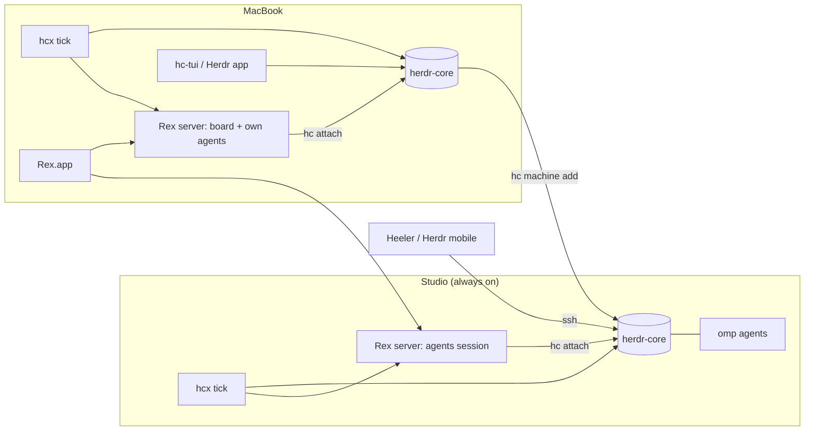

# hcx

Coding agents (omp) on several Macs, kept in **herdr-core** (`hc`) and shown everywhere:
hc-tui in a terminal, the Herdr app, Rex, and Heeler on the phone. hcx is the glue:

- **Keeps agents resumable.** Every minute it adopts any omp running in hc, records its
  conversation file and command line, and after a reboot restarts each one where it left off.
- **Mirrors agents into Rex.** Each Mac's Rex gets an `agents` session: a tab per space, its
  agents side by side. A pane outlives its agent: quit omp and it offers to revive it on the
  same conversation. The Mac you sit at also gets a `board` tab listing every agent on every Mac.
- **Drives agents from Rex.** Palette actions to jump to an agent, read its output, message
  it, answer it when it's blocked, start a new one, or float hc-tui over any window.
- **Makes agents behave in hc.** omp extensions draw the `<hc from="…">` messages agents send
  each other as a small card, name each session after its terminal (so Heeler and hc-tui show
  `scaleup-lead`, not a generated title), and refuse the herdr CLI and killing other agents.
- **Moves agents off Herdr TUI** with their conversations intact (`hcx-migrate-herdr`).

Agents never live in Rex or any other UI, so any UI can be closed, restarted, swapped or
forked without touching them.



## Quick start

On each Mac, with nix-darwin and home-manager:

```nix
# flake.nix
inputs.hcx.url = "git+file:///Users/nich/code/hcx";   # a local checkout; see docs/operations.md

# the host's modules
imports = [ inputs.hcx.darwinModules.default ];
services.hcx = {
  enable = true;
  board = true;            # only on the Mac you sit at
  openRexAtLogin = false;  # true on the Mac that hosts agents for others (the Studio)
};
```

Install the Herdr app (it brings herdr-core) and Rex.app, then load the Rex actions from
`~/.config/rex/init.lua` on the Mac your Rex.app follows for keys:

```lua
dofile(os.getenv("HOME") .. "/.config/rex/hcx.lua")
```

## Keys (Rex)

| Key | Action |
|---|---|
| `cmd+shift+a` | Agents…: go to its tab, read output, send a message, interrupt |
| `cmd+shift+b` | Answer Blocked Agent… (a single digit picks that option) |
| palette | New Agent… (this Mac or another, any folder) |
| `cmd+shift+space` | Toggle hc-tui floating over this window |
| `cmd+shift+f` | Fit Agent to This Pane (rarely needed: Rex refits on focus) |

## Docs

- [Setup from scratch](docs/setup.md): every step to rebuild both Macs, in order.
- [Architecture](docs/architecture.md): components, where things run, data flows, lifecycle.
- [Operations](docs/operations.md): the module's options, day-to-day commands (incl.
  `hcx restart-idle`), bumping hc-tui.
- [Maintenance](docs/maintenance.md): check / rollout / status scripts, tested versions,
  upgrading each component, the smoke test, adding a Mac.
- [Migrating from Herdr TUI](docs/migrating-from-herdr.md): moving live agents and teams.
- [The Herdr app, our way](docs/herdr-app.md): Ghostty's Everforest look and a Normal mode with
  a space leader, as a theme and a mod (no fork).
- [Troubleshooting](docs/troubleshooting.md): known failure modes and their fixes.
- [Decisions](docs/decisions.md): why it's built this way, with the evidence.
- [Changelog](CHANGELOG.md)

## Layout

| Path | What |
|---|---|
| `bin/hcx` | tick, resume, revive, Rex sync, `view`, `agents`, `board`, `fit` |
| `scripts/hcx-migrate-herdr` | move one agent off Herdr TUI |
| `scripts/check`, `scripts/rollout`, `scripts/status`, `scripts/omp-canary` | maintenance (see docs/maintenance.md) |
| `rex/hcx.lua` | Rex palette actions and keys |
| `omp/hc-notes.ts`, `omp/hc-name.ts`, `omp/hc-guard.ts` | omp extensions: render hc messages, name sessions after their terminal, guard other agents |
| `herdr/` | Herdr app theme (`themes/`), mods (`mods/vim`), and `herdr/apply` to put them in place |
| `skills/hc/SKILL.md` | the `hc` agent skill |
| `nix/module.nix`, `nix/packages.nix`, `flake.nix` | the nix-darwin module and packages |
